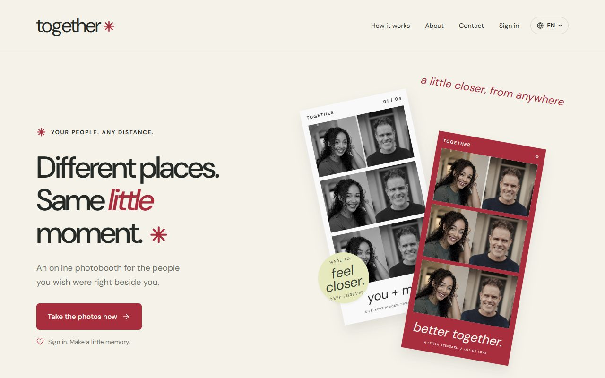
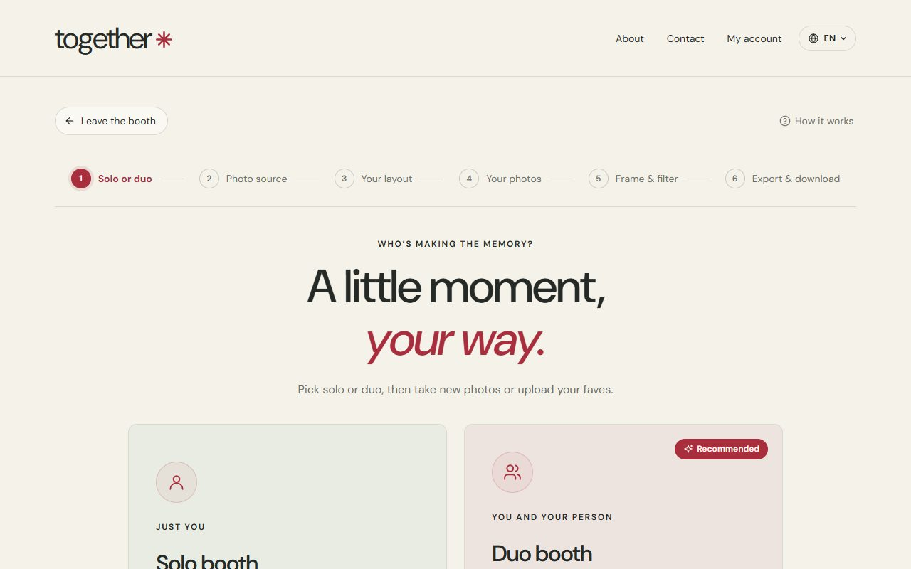
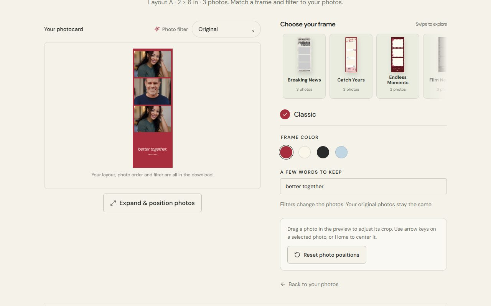
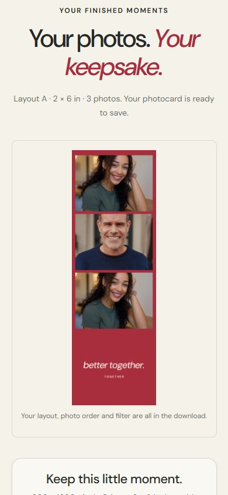

<div align="center">

# together ✳

**An online photobooth for the people you wish were right beside you.**

Take photos together from different places, pick a frame and filter,<br>
and keep a little photocard of the moment.

[**togetherphotobooth.xyz**](https://togetherphotobooth.xyz)




</div>

---

## About

**Together** is a browser-based photobooth made for long-distance couples, friends
in different time zones and families living apart. Two people join the same booth
from their own phones or laptops, take photos live together, and get one shared
photocard to download, print or set as a wallpaper.

No app to install: it runs in the browser on phones and computers.

## Features

- **Solo or Duo booth**: take photos alone, or invite your person with a link or party code
- **Live duo cameras**: both cameras connect directly (WebRTC), with a shared countdown, flash and mirror
- **Take or upload**: shoot new photos, or turn favourites from your gallery into a photocard
- **8 layouts and supplied frame designs**: strips, grids, a newspaper card and more
- **Filters and fine-tuning**: photo filters, drag to re-crop, reorder or retake any shot
- **Download or print**: PNG/JPG export at print resolution (e.g. 2 × 6 in at 300 dpi)
- **3 languages**: English, Burmese (မြန်မာ) and Vietnamese (Tiếng Việt)
- **Picks up where you left off**: unfinished sessions can be resumed after a refresh
- **Points and a free first session**: every account gets one free session; extra sessions use points

## Screenshots

<table>
  <tr>
    <td width="50%"><br><sub><b>Step 1:</b> choose Solo or Duo, with a clear six-step progress bar.</sub></td>
    <td width="50%"><br><sub><b>Frame & filter:</b> live preview next to frames, colours and captions.</sub></td>
  </tr>
  <tr>
    <td colspan="2" align="center"><br><sub><b>On a phone:</b> the finished photocard, ready to download.</sub></td>
  </tr>
</table>

## How it works

1. **Choose** Solo or Duo, then take new photos or upload your own.
2. **Pick a layout**. It decides how many photos you need.
3. **Snap** with a timer, flash and mirror (or upload). In Duo, you share a link and shoot together live.
4. **Confirm** your session (free the first time, then 100 points).
5. **Style it** with a frame, filter, colour and a few words.
6. **Download** or print your photocard.

## Privacy by design

- **Photos never reach our servers.** They're captured and edited in the browser.
  In Duo, photos travel straight between the two devices over a WebRTC data channel.
- Only the booth "handshake" (signalling) goes through the server; never images or video.
- Payment receipts are stored privately and only visible to the account owner and admins.
- Every database table uses Row Level Security; admin rights are tied to a user ID, not an email.

## Tech stack

| Area | Tools |
|---|---|
| Frontend | React 19, TypeScript, Vite 7, plain CSS (no UI framework), DM Sans |
| Photos | Canvas rendering, a Web Worker for filters, WebRTC for live duo cameras |
| Backend | Supabase: Auth (Google + email/password), Postgres with RPC functions, Realtime, Storage, Edge Functions |
| Server functions | Vercel serverless functions (`website/api/`) |
| Email | Resend (sign-up, password reset and payment emails) |
| Networking & security | Cloudflare TURN relay, Cloudflare Turnstile captcha |
| Tests | Node.js test runner, PGlite (real Postgres in tests) |
| Tooling | pnpm, GitHub, Vercel (staging + production) |

## Project structure

```
website/
├── src/
│   ├── booth/        # booth flow: Booth.tsx (coordinator), camera, duo connection, editor, export
│   ├── auth/         # sign-in, account, wallet, buying points
│   ├── pages/        # Home, About, Terms, Privacy, Refunds, Contact
│   ├── components/   # shared UI: icons, dialogs, language switcher
│   ├── i18n/         # translations: en.ts (source), my.ts, vi.ts
│   └── styles/       # global styles
├── api/              # Vercel functions: booth rooms, sign-in, payment emails
├── server/           # shared server logic (rooms, auth cache, TURN, emails)
├── supabase/         # Edge Function for branded auth emails
├── tests/            # automated tests
└── 0NN-*.sql         # database migrations (run in order in Supabase)
```

## Getting started

**Requirements:** Node.js 24 and pnpm 10.

```bash
cd website
pnpm install
cp .env.example .env   # then fill in your own Supabase / TURN / Resend values
pnpm dev               # http://localhost:5173
```

The `.env.example` file lists every setting. Keys without the `VITE_` prefix are
server-only and must never be exposed to the browser.

### Useful commands

| Command | What it does |
|---|---|
| `pnpm dev` | Start the local preview |
| `pnpm test` | Run all automated tests |
| `npx tsc --noEmit` | Type-check the project |
| `pnpm build` | Type-check and build for production (`dist/`) |

### Database

Migrations live in `website/` as `001-…sql` to `020-…sql`. Run them in order in
the Supabase SQL Editor. Setup notes for auth, payments, email and the duo camera
relay are in the `website/*.md` guides.

## Deployment

| Branch | Deploys to |
|---|---|
| `staging` | Staging site (staging Supabase project), used for testing |
| `master` | [togetherphotobooth.xyz](https://togetherphotobooth.xyz) (production) |

Changes are tested on `staging` first, then merged into `master` to go live.

## Status

Together is in its **testing stage**, with a paid launch planned.
More frames and features are on the way.

## Contact

- Email: [togetherphotobooth.xyz@gmail.com](mailto:togetherphotobooth.xyz@gmail.com)
- TikTok: [@togetherphotobooth](https://www.tiktok.com/@togetherphotobooth)

Built by **Zwe Lin Naing**, a student learning computer science and software
engineering, with a little help from AI along the way.

---

<sub>© 2026 Zwe Lin Naing. All rights reserved. This code is shared for viewing; please ask before reusing it.</sub>
